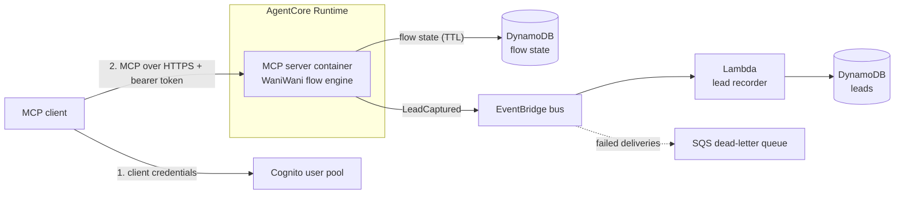

# WaniWani MCP funnel on Amazon Bedrock AgentCore

An MCP server built with the open-source [WaniWani SDK](https://github.com/WaniWani-AI/sdk),
hosted on Amazon Bedrock AgentCore Runtime and deployed with the AWS CDK.

The server exposes one funnel — an indicative rooftop solar quote — as a single MCP tool. The
WaniWani flow engine keeps the conversation deterministic: fixed question order, typed and
validated answers, branching, and state that survives between tool calls. Everything it needs on
AWS is serverless.

> [!NOTE]
> The WaniWani SDK is used here as a library only. The demo deploys and runs without a WaniWani
> account; the hosted WaniWani Platform is an [opt-in](#optional-waniwani-platform).

## Architecture



| Stack                                           | Contents                                                              |
| ----------------------------------------------- | --------------------------------------------------------------------- |
| `agentcore-waniwani-mcp-funnel-stateful-<env>`  | Flow state table, leads table, Cognito user pool and its M2M client.  |
| `agentcore-waniwani-mcp-funnel-stateless-<env>` | AgentCore Runtime, container image, EventBridge bus and rule, Lambda. |

### How the pieces fit

- **Stateless transport, stateful funnel.** AgentCore Runtime expects a stateless Streamable HTTP
  server on `0.0.0.0:8000/mcp`. The server builds a fresh MCP server per request, so any instance
  can serve any call. The funnel's state lives in DynamoDB, keyed by the `Mcp-Session-Id` header
  that AgentCore adds to every request.
- **Bring-your-own store.** The SDK's store interface is `get` / `set` / `delete`.
  `src/mcp-server/dynamo-kv-store.ts` implements it on DynamoDB, with a TTL so abandoned
  conversations expire (24 hours by default).
- **The price is computed server-side.** Every flow state field is writable from the
  conversation, so the quote is calculated in the flow's `quote` step, and the result fields are
  marked `neverPrefilled` so the model cannot supply them.
- **Results go through a display tool.** A finished WaniWani flow returns only
  `status: "complete"`. The last step therefore tells the model to call
  `show_solar_quote_result`, which renders the outcome as text.
- **Leads leave by event.** The `quote` step publishes a `LeadCaptured` event. A Lambda function
  persists it, keyed by a lead id that is stable per session, so retries overwrite instead of
  duplicating.

## Prerequisites

- [Node.js](https://nodejs.org/) 22 or later and npm 10 or later
- Docker, able to build `linux/arm64` images (native on Apple silicon and Graviton; elsewhere,
  enable QEMU emulation, for example with `docker run --privileged --rm tonistiigi/binfmt --install arm64`)
- An AWS account and credentials available to the AWS CLI / SDK
- A region where Amazon Bedrock AgentCore is available, [bootstrapped for CDK v2](https://docs.aws.amazon.com/cdk/v2/guide/bootstrapping.html)

## Run it locally

No AWS account needed: state is kept in memory and leads are logged instead of published.

```bash
npm ci
npm run dev:server                                  # MCP server on http://localhost:8000/mcp

# In another terminal: walk the funnel with a real MCP client.
MCP_URL=http://localhost:8000/mcp npm run smoke
```

## Deploy

```bash
npm ci
npx cdk bootstrap          # one-time per account/region
npx cdk deploy --all
```

Deploy the production configuration with `npx cdk deploy --all -c env=prod`.
Environment-specific settings live in `lib/shared/config.ts`.

## Try the deployed server

The server accepts OAuth 2.0 access tokens from the Cognito machine-to-machine client. Collect
the values from the stack outputs and run the smoke test:

```bash
STATEFUL=agentcore-waniwani-mcp-funnel-stateful-dev
STATELESS=agentcore-waniwani-mcp-funnel-stateless-dev
output() {
  aws cloudformation describe-stacks --stack-name "$1" \
    --query "Stacks[0].Outputs[?OutputKey=='$2'].OutputValue" --output text
}

export RUNTIME_ARN=$(output $STATELESS RuntimeArn)
export TOKEN_ENDPOINT=$(output $STATEFUL TokenEndpoint)
export CLIENT_ID=$(output $STATEFUL McpClientId)
export CLIENT_SECRET=$(aws cognito-idp describe-user-pool-client \
  --user-pool-id "$(output $STATEFUL UserPoolId)" --client-id "$CLIENT_ID" \
  --query UserPoolClient.ClientSecret --output text)

npm run smoke
```

A successful run prints each funnel step, the quote, and `Smoke test passed.` The captured lead
then appears in the leads table:

```bash
aws dynamodb scan --table-name "$(output $STATEFUL LeadsTableName)" --max-items 5
```

To connect another MCP client, use the endpoint
`https://bedrock-agentcore.<region>.amazonaws.com/runtimes/<URL-encoded RuntimeArn>/invocations?qualifier=DEFAULT`
with an `Authorization: Bearer <access token>` header.

## Optional: WaniWani Platform

Setting a WaniWani API key turns on the hosted Platform's funnel analytics and event tracking.
Store the key in Secrets Manager and pass the secret's ARN at deploy time:

```bash
aws secretsmanager create-secret --name waniwani-api-key --secret-string '<your key>'
npx cdk deploy --all -c waniwaniApiKeySecretArn=<secret ARN>
```

The server reads the secret at start-up; the key is never placed in an environment variable or a
template. Flow state stays in DynamoDB either way. With a key set, tool-call events — including
the answers users give — are sent to WaniWani's service.

## Observability

The MCP server writes one structured log line per request to CloudWatch Logs. Each line says
where a conversation is in the funnel; it records field names, never the answers:

```json
{
  "message": "mcp_request",
  "sessionId": "…",
  "method": "tools/call",
  "tool": "solar_quote",
  "flowAction": "continue",
  "answeredFields": ["monthlyBillUsd"],
  "flowStatus": "interrupt",
  "askedFields": ["name", "email"],
  "httpStatus": 200,
  "durationMs": 3
}
```

AgentCore Runtime creates the log group. Find it and follow it:

```bash
aws logs describe-log-groups --log-group-name-prefix /aws/bedrock-agentcore/runtimes/ \
  --query 'logGroups[].logGroupName' --output text

aws logs tail <log group> --follow --since 30m
```

Two CloudWatch Logs Insights queries to start from:

```text
# One conversation, step by step
fields @timestamp, flowAction, answeredFields, flowStatus, askedFields, outcome, durationMs
| filter message = "mcp_request" and sessionId = "<session id>"
| sort @timestamp asc

# Funnel reach: how many conversations were asked each question
filter message = "mcp_request" and tool = "solar_quote" and flowStatus = "interrupt"
| stats count_distinct(sessionId) as sessions by askedFields.0
```

The lead recorder logs one line per lead to
`/aws/lambda/agentcore-waniwani-mcp-funnel-<env>-lead-recorder`. Runtime-level metrics
(invocations, latency, errors, sessions) are in the `bedrock-agentcore` CloudWatch namespace.
Distributed tracing is not set up: it needs OpenTelemetry in the container and CloudWatch
Transaction Search, which is an account-wide, usage-billed setting.

## Limitations

- **Machine-to-machine auth only.** The Cognito client uses the client-credentials grant, which
  suits agents and scripts. Connecting a consumer chat client (Claude, ChatGPT) needs an
  interactive OAuth flow and is not set up here.
- **No UI widgets.** The SDK can render React widgets in clients that support MCP Apps. This demo
  returns text only.
- **Illustrative pricing.** The quote maths in `src/mcp-server/quote.ts` is made up for the demo.

## Project structure

```text
bin/                              CDK app entry point
lib/stateful-stack.ts             Tables and Cognito
lib/stateless-stack.ts            AgentCore Runtime, EventBridge, Lambda
lib/shared/config.ts              Per-environment configuration (dev/prod)
src/mcp-server/flow.ts            The funnel, defined with the WaniWani SDK
src/mcp-server/server.ts          Stateless Streamable HTTP server (/mcp, /ping)
src/mcp-server/dynamo-kv-store.ts WaniWani flow store on DynamoDB
src/mcp-server/request-log.ts     One structured log line per MCP request
src/mcp-server/main.ts            Container entry point and environment wiring
src/handlers/lead-recorder/       Lambda that persists captured leads
scripts/smoke.ts                  End-to-end walk of the funnel over MCP
Dockerfile                        ARM64 image for AgentCore Runtime
test/                             Jest tests, including CDK snapshots
```

## Useful commands

| Command              | Description                                        |
| -------------------- | -------------------------------------------------- |
| `npm test`           | Type-check, then run the Jest suite                |
| `npm run lint`       | Run ESLint                                         |
| `npm run synth`      | Synthesize the CloudFormation templates            |
| `npm run dev:server` | Bundle and run the MCP server locally              |
| `npm run smoke`      | Walk the funnel against a local or deployed server |
| `npm run deploy`     | Deploy all stacks                                  |
| `npm run destroy`    | Destroy all stacks                                 |

Snapshot tests are updated with `npm test -- -u`.

## CI/CD

The repository's root workflows cover this demo:

- `.github/workflows/ci-agentcore-waniwani-mcp-funnel.yml` — on pull requests: lint, test,
  `cdk synth`.
- `.github/workflows/deploy-agentcore-waniwani-mcp-funnel.yml` — on push to `main`: assume an AWS
  role via OIDC, build the ARM64 image under QEMU, and run `cdk deploy --all`.

## Cleanup

```bash
npx cdk destroy --all
```

In `prod` the tables and the user pool are created with a `RETAIN` removal policy and must be
removed manually. The container image stays in the CDK bootstrap ECR repository until deleted.

## License

This library is licensed under the MIT-0 License. See the [LICENSE](LICENSE) file.
